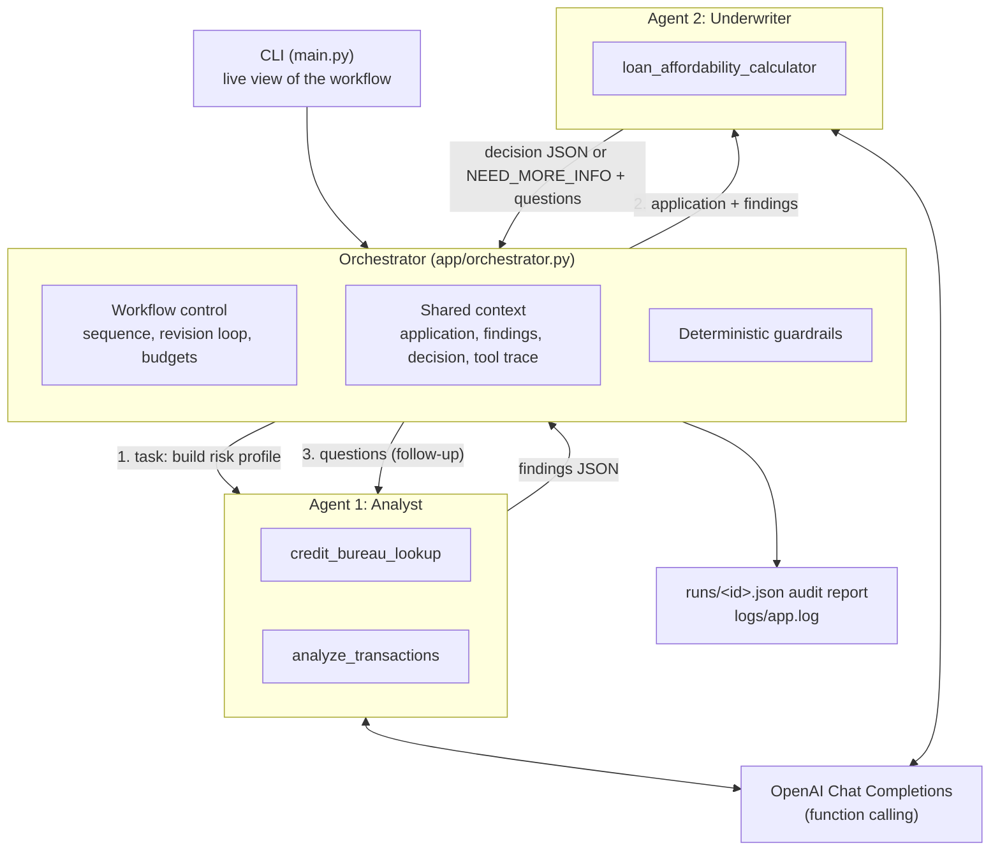

# Agentic Loan Pre-Assessment

A small, runnable Agentic AI application for FinTech: an **orchestrator** coordinates **two AI agents**
(Analyst and Underwriter) that use **three FinTech tools** to pre-assess a personal-loan application,
collaborate when information is missing, and produce an auditable decision.

---

## 1. Why this use case

Loan pre-assessment is a good vehicle for showing what "agentic" means, because:

| Agentic concept | How the use case exercises it |
|---|---|
| **Reasoning + tool use** | The decision needs facts the model does not have (credit report, bank transactions, an exact instalment). The LLM must decide *which* tool to call, with *what* arguments, and interpret the result. |
| **Specialised agents** | Real lenders separate evidence gathering (analyst) from decision making (underwriter). Each agent gets its own prompt and only the tools its role needs. |
| **Collaboration** | When the Underwriter sees an unexplained risk (e.g. gambling spend) it asks questions; the orchestrator routes them back to the Analyst, who investigates with a deeper tool call. |
| **Orchestration** | A central component controls order, shared context, loop limits and failure handling. Agents never call each other directly. |
| **Guardrails / human-in-the-loop** | Finance is regulated: the LLM's decision is checked against raw tool outputs by deterministic code, and anything uncertain is sent to a human (`REFER_TO_HUMAN`). |
| **Auditability** | Every tool call, argument and result is saved to `runs/<id>.json`, the kind of trail a credit decision needs. |

It is also easy to explain in one sentence: *"Two AI colleagues, an analyst and an underwriter, assess a loan
using a credit bureau, a bank feed and a calculator, and a supervisor checks their work."*

---

## 2. Architecture



**Inside each agent** (the ReAct-style loop in `app/agents/base.py`):

```
 task ─► LLM ──tool_calls?──yes──► execute tool(s) ─► append results ─┐
          ▲                                                            │
          └────────────────────────────────────────────────────────────┘
          │ no
          ▼
   final JSON answer ─► validate keys ─► (one re-ask if invalid) ─► return
   (stops after MAX_AGENT_STEPS)
```

### Responsibilities

**Orchestrator** (`LoanOrchestrator`)
- Validates the application and creates a run ID.
- Sequences the agents: Analyst → Underwriter → (optional) Analyst follow-up → Underwriter.
- Holds the shared context: agents exchange data only through it, as JSON.
- Bounds collaboration with `MAX_REVISIONS` so agents cannot loop forever.
- Applies guardrails that trust **tool outputs, not agent narration**:
  - an approval must be backed by an affordability calculation for the *requested* amount and term;
  - verified DTI above 45% or a bureau default overrides an approval to `REFER_TO_HUMAN`;
  - unknown decisions or unresolved `NEED_MORE_INFO` go to a human;
  - the stated monthly payment is corrected to the calculator's figure.
- Fails safe: any LLM/agent failure yields `FAILED` + `REFER_TO_HUMAN`, never an approval.
- Saves the full report to `runs/`.

**Agent 1: Analyst** (`app/agents/analyst.py`), tools: credit bureau, transactions
- Gathers evidence and writes a factual risk profile: key metrics, risk flags, positives, data gaps.
- On follow-up, drills into a category (e.g. gambling) and answers the Underwriter's questions.
- Does not decide. Must not invent numbers; tool errors are recorded as data gaps.

**Agent 2: Underwriter** (`app/agents/underwriter.py`), tool: affordability calculator
- Prices the loan from the credit score, runs the affordability calculation, applies policy.
- Returns `APPROVE`, `CONDITIONAL_APPROVE` (with conditions), `DECLINE`, or `NEED_MORE_INFO` with questions.

### The three tools (`app/tools/`)

| Tool | What it does | Real-world equivalent |
|---|---|---|
| `credit_bureau_lookup(applicant_id)` | Score, band, utilisation, defaults, late payments, inquiries, bureau flags | Experian / Equifax / CRIB API |
| `analyze_transactions(applicant_id, focus_category?)` | 3-month income, expenses, debt payments, net cash flow, income volatility, behavioural flags; or raw rows for one category | Open-banking aggregator (Plaid, TrueLayer) |
| `loan_affordability_calculator(principal, annual_rate_pct, term_months, monthly_income, existing_monthly_debt)` | Amortised instalment, total interest, DTI before/after, affordability band | Bank pricing / affordability engine |

Tools are plain Python functions with a JSON schema. The registry returns errors to the agent as
`{"error": ...}` instead of raising, so the model can recover (fix arguments, or report the gap).
Each agent has an allow-list, so the Analyst cannot call the calculator and vice versa.

---

## 3. Technology stack

| Choice | Why |
|---|---|
| Python 3.10+ | Standard for AI work; readable for a walkthrough |
| `openai` SDK, Chat Completions with function calling | Native tool calling; built-in retries for 429/5xx/timeouts |
| No agent framework | The loop is ~100 lines, so every concept is visible. LangGraph, OpenAI Agents SDK or CrewAI are natural next steps once the fundamentals are clear |
| `rich` | Readable live CLI output |
| `python-dotenv` | Configurable API key and settings via `.env` |
| `logging` | File log for detail, console for warnings only |
| `pytest` | Tests run offline via the mock LLM and scripted LLM |

---

## 4. Project structure

```
fintech-agents/
├── main.py                    # CLI: interactive menu, list, assess, demo
├── app/
│   ├── config.py              # Settings from env/.env, API key validation
│   ├── logging_setup.py       # logs/app.log + console warnings
│   ├── llm.py                 # OpenAI wrapper -> provider-neutral LLMResponse, error mapping
│   ├── mock_llm.py            # Offline deterministic "LLM" for demos/tests (--mock)
│   ├── data.py                # Sample data access (stands in for external APIs)
│   ├── orchestrator.py        # Workflow, shared context, guardrails, audit report
│   ├── agents/
│   │   ├── base.py            # The agent loop (reason -> act -> observe -> answer)
│   │   ├── analyst.py         # Agent 1 prompt + tools
│   │   └── underwriter.py     # Agent 2 prompt + tools
│   └── tools/
│       ├── base.py            # Tool + ToolRegistry (safe execution, allow-lists)
│       ├── credit_bureau.py   # Tool 1
│       ├── transactions.py    # Tool 2
│       └── affordability.py   # Tool 3
├── data/applicants.json       # 4 fictional applicants with credit files and transactions
├── tests/                     # 23 tests: tools, scenarios, failures, guardrails, OpenAI wiring
├── runs/                      # (generated) one JSON audit report per assessment
└── logs/                      # (generated) app.log
```

---

## 5. Setup and run

```bash
cd fintech-agents
python -m venv .venv
source .venv/bin/activate            # Windows: .venv\Scripts\activate
pip install -r requirements.txt
cp .env.example .env                 # Windows: copy .env.example .env
# edit .env and set OPENAI_API_KEY (and OPENAI_MODEL if you prefer another model)
```

```bash
python main.py                                   # interactive menu
python main.py list                              # sample applicants
python main.py demo                              # four scenarios end to end
python main.py assess A002 --amount 12000 --term 36 --purpose "debt consolidation"
python main.py -v assess A001 --amount 20000 --term 36   # verbose: full tasks and tool results
python main.py --mock demo                       # offline, no API key needed
python -m pytest -q                              # tests (offline)
```

### Sample applicants and what each demonstrates

| ID | Profile | What it shows |
|---|---|---|
| A001 | Excellent score, low debt | Straight path: 2 tools → calculator → APPROVE |
| A002 | Fair score, gambling spend | **Collaboration loop**: Underwriter asks, Analyst drills in, Underwriter decides |
| A003 | Default, overdrafts, high DTI | DECLINE with policy reasons |
| A004 | Self-employed, irregular income, thin file | Reasoning about *which* income to use; CONDITIONAL_APPROVE with conditions |

With a real model the exact wording, and occasionally the decision, can vary run to run; that is expected
and worth discussing. The guardrails keep any variation inside policy.

---

## 6. Step-by-step implementation guide

Build in this order; each step is testable on its own.

1. **Tools first** (`app/tools/`). Write each as a pure function with input validation and a `ToolError`
   for domain failures. Add a JSON schema with clear descriptions: the description *is* the model's
   documentation. Test with plain pytest, no LLM.
2. **Tool registry** (`tools/base.py`). One `execute()` that parses arguments, enforces the agent's
   allow-list, and converts every exception to `{"error": ...}`. Log each call with timing.
3. **LLM wrapper** (`llm.py`). Call `chat.completions.create(model, messages, tools, tool_choice="auto")`,
   map SDK exceptions to one `LLMError` with a human-readable message, and return a small `LLMResponse`
   dataclass so the rest of the code does not depend on the SDK.
4. **Agent loop** (`agents/base.py`). Loop up to `max_steps`: call the LLM; if it requested tools,
   append the assistant message with `tool_calls`, execute each, append `role: "tool"` messages with the
   matching `tool_call_id`, and loop. Otherwise parse the final JSON, check required keys, re-ask once if
   invalid. Emit events at each stage for the UI.
5. **Agents** (`analyst.py`, `underwriter.py`). Subclass and set four things: name, system prompt (role,
   procedure, output schema), tool allow-list, required output keys. Put policy in the prompt so it is
   explicit and reviewable.
6. **Orchestrator** (`orchestrator.py`). Sequence the agents, pass context as JSON, implement the bounded
   `NEED_MORE_INFO` loop, then guardrails, then persist the report. Catch `AgentError`/`LLMError` and fail safe.
7. **Mock LLM** (`mock_llm.py`). A rule-based stand-in that speaks the same protocol (requests tools, reads
   results, answers JSON). It lets you test the whole pipeline offline and rehearse the demo.
8. **CLI** (`main.py`). Subscribe to orchestrator events to render the live trace; render the final report.
9. **Tests**. Scenario tests via the mock; failure tests via a scripted LLM (bad JSON, step budget, API
   failure, a deliberately wrong approval that guardrails must catch).

---

## 7. Error handling and logging

| Failure | Handling |
|---|---|
| Missing API key | Clear message at startup, exit code 2 |
| Bad key / unknown model / rate limit / network | SDK retries (3), then `LLMError` with a readable message → run `FAILED`, `REFER_TO_HUMAN` |
| Tool error (unknown applicant, invalid input) | Returned to the agent as `{"error": ...}`; Analyst records a data gap |
| Model calls a tool it is not allowed | Rejected by the registry allow-list, reported back to the model |
| Malformed final answer | One corrective re-ask, then `AgentError` |
| Agent loops on tools | Stopped by `MAX_AGENT_STEPS` |
| Agents keep asking each other | Stopped by `MAX_REVISIONS` → `REFER_TO_HUMAN` |
| LLM approves against the numbers | Guardrail override using raw calculator / bureau results |

`logs/app.log` records every LLM call (latency, tokens), tool call (arguments, timing, errors), stage, and
outcome. `runs/<id>.json` holds the complete decision record.

---

## 8. Suggested demo script (about 10 minutes)

1. Show the architecture diagram; explain the orchestrator, two agents, three tools.
2. `python main.py assess A001 --amount 20000 --term 36` — point out the agent choosing tools and arguments.
3. `python main.py assess A002 --amount 12000 --term 36` — the highlight: NEED_MORE_INFO, the follow-up
   with `focus_category`, and the second underwriting round.
4. Open `runs/<id>.json` — the audit trail.
5. Run `python -m pytest -q` and walk through `test_guardrail_overrides_unsupported_approval`: an LLM that
   approves against the numbers is overridden.
6. Discuss limits and next steps (below).

## 9. Limitations and next steps

- Sample data stands in for real bureau and banking APIs; there is no PII handling, consent, or KYC.
- Policy thresholds are illustrative, not a real credit policy; this is a pre-assessment, not a lending decision.
- Next steps: structured outputs (JSON schema enforcement), parallel tool calls, a web UI (Streamlit/FastAPI),
  persistence in a database, an evaluation set of applicants with expected decisions, fairness checks on
  decisions, and porting the orchestrator to LangGraph or the OpenAI Agents SDK.
# fintech-agents
